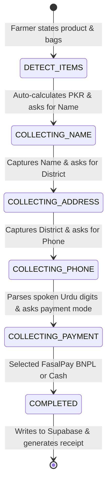

# 🌾 SONA AI: Comprehensive Project Context & Master Specification

> **Autonomous Voice-First Agri-Fintech Agent & Fulfillment Pipeline**  
> *Powered by fastn MCP, Multimodal Intelligence, and Conversational BNPL*

---

## 1. Executive Vision & Core Thesis

### The Vision
To empower Pakistan’s 8+ million smallholder farmers with **zero-barrier conversational intelligence** and **instant credit-backed agricultural fulfillment**. Sona AI transforms agricultural support from passive text articles into an autonomous voice-first agronomist and financial facilitator accessible to every farmer, regardless of literacy level.

### The Core Thesis
1. **The Literacy Reality:** Over 70% of rural Pakistani farmers cannot read, write, or navigate complex smartphone dashboards. Text chatbots (WhatsApp bots) fundamentally fail in the field. **Voice is the only viable interface.**
2. **Beyond "Chatbots" to Action Pipelines:** Farmers don't just need generic advice; they need **timely, risk-checked actions**—calculating exact acreage dosages, preventing fertilizer loss before rains, and booking fertilizer on harvest credit (FasalPay BNPL) with delivery through local dealers.
3. **Decoupled Architecture with fastn & MCP:** By migrating from hardcoded logic to the **Model Context Protocol (MCP)** orchestrated by **fastn**, Sona AI becomes an enterprise-grade ecosystem where any AI agent can dynamically trigger agronomy calculators, weather checks, and dealer ERP workflows without custom glue code.

---

## 2. Problem Statement & Market Opportunity

| Problem | Rural Reality | Sona AI Solution |
| :--- | :--- | :--- |
| **Literacy & UI Barrier** | Farmers struggle to type in apps or read Roman/Urdu text. | **Voice-First Engine:** Native Urdu/Punjabi voice recognition, spoken colloquial number decoding, and studio-grade voice replies. |
| **Climate & Leaching Loss** | Applying Urea right before rain causes nitrogen runoff, wasting Rs. 8,000–15,000/acre. | **Pre-Application Weather Guard:** Checks localized rain forecasts before advising or approving fertilizer application. |
| **Fragmented Credit (BNPL)** | Smallholders lack formal credit cards or bank access during sowing season. | **FasalPay BNPL Voice Checkout:** Farmers book essential fertilizers with deferred payment at harvest time in under 60 seconds. |
| **Dealer Disconnect** | Farmers travel miles only to find local stock empty or priced above MRP. | **Automated Dealer Dispatch:** Books orders directly into the dealer cloud ledger (`/orders`), routing stock from the nearest branch. |

---

## 3. High-Level System Architecture

```
                       ┌──────────────────────────────────────────────┐
                       │          FARMER (VOICE / CHAT / APP)         │
                       └──────────────────────┬───────────────────────┘
                                              │ (Spoken Urdu / Web Mic)
                                              ▼
                       ┌──────────────────────────────────────────────┐
                       │     STT & PHONETIC COLLOQUIAL PARSER         │
                       │    (Decodes "zero teen so ath..." -> 0308)   │
                       └──────────────────────┬───────────────────────┘
                                              │
                                              ▼
                       ┌──────────────────────────────────────────────┐
                       │    fastn AGENT ORCHESTRATION PIPELINE        │
                       │  - Intelligent Query Classifier              │
                       │  - Advisory vs. Order Intent Separation      │
                       └──────────────────────┬───────────────────────┘
                                              │ (Model Context Protocol)
                                              ▼
 ═════════════════════════════════════════════════════════════════════════════════════════
                              ⚡ SONA FastMCP TOOL LAYER ⚡
 ═════════════════════════════════════════════════════════════════════════════════════════
       │                        │                       │                     │
       ▼                        ▼                       ▼                     ▼
 ┌───────────────┐      ┌───────────────┐       ┌───────────────┐     ┌───────────────┐
 │ WEATHER TOOL  │      │  DOSAGE TOOL  │       │  CREDIT TOOL  │     │ DISPATCH TOOL │
 │ Rain/Leaching │      │  NPK Bags/Acre│       │ FasalPay BNPL │     │ Supabase/DB   │
 │ Risk Analysis │      │ Scientific Cal│       │ Qualification │     │ Dealer Route  │
 └───────┬───────┘      └───────┬───────┘       └───────┬───────┘     └───────┬───────┘
         │                      │                       │                     │
 ═════════════════════════════════════════════════════════════════════════════╪═══════════
                                                                              │
                                                                              ▼
                                                               ┌──────────────────────────┐
                                                               │  SUPABASE CLOUD LEDGER   │
                                                               │  & ADMIN PORTAL (/orders)│
                                                               └──────────────────────────┘
```

---

## 4. End-to-End Workflow & State Machine

The Sona AI core operates two distinct, intelligent execution pathways:

### Pathway A: Scientific Advisory (Non-Disruptive)
* **Trigger:** Questions mentioning dosage, comparison, symptoms, or acreage (e.g. *"میری 5 ایکڑ گندم ہے، کتنا کھاد لگے گا؟"* or *"کین گوارا اور عام یوریا میں کیا فرق ہے؟"*).
* **Execution:** Routed through the **Weather & Dosage MCP Tools** backed by Gemini 3.1 Pro/Flash cascading models.
* **Output:** Precise, concise answers (2–3 lines maximum) explaining application timing without pushing unprompted sales.

### Pathway B: Multi-Turn Voice Order Flow (Slot-Filling Engine)
When an explicit purchase intent is detected (e.g., *"مجھے 10 بوری کین گوارا آرڈر کرنی ہیں"*):



1. **Step 1 (Items & Pricing):** Auto-identifies bags (digits, Urdu words like `دس`, `چوبیس`, `پچاس`) and matches prices:
   * Sarsabz / Sona CAN Gowara: **Rs. 3,900 / bag**
   * Sarsabz Nitrophos (NP): **Rs. 8,200 / bag**
   * Sarsabz / Sona Urea: **Rs. 4,400 / bag**
   * Sarsabz Zinc: **Rs. 1,200 / pack**
2. **Step 2 (Name):** Cleans prefixes (*"میرا نام..."*) and stores farmer identity.
3. **Step 3 (District):** Logs delivery location (e.g., *خانیوال*, *ملتان*, *فیصل آباد*).
4. **Step 4 (Colloquial Phone Parsing):** Parses spoken dialects e.g. `"zero teen so ath, artali pandra no so"` $\rightarrow$ `0308-4815900` with strict Left-To-Right (LTR) unicode formatting.
5. **Step 5 (Payment & Settlement):** Selects **فصل پے قرضہ (Pay at Harvest)** or **نقد (Cash)**, creates a unique order tracking ID (`FP-XXXXX`), logs it into Supabase, and displays a WhatsApp-style green receipt with audio playback.

---

## 5. Technical Stack & Implementation Map

| Layer | Technology | File Location | Responsibility |
| :--- | :--- | :--- | :--- |
| **Orchestration & Tools** | FastMCP / fastn | `sona_fastmcp.py` | Exposes standard MCP tools for weather, dosage, and order booking. |
| **Backend & Routing** | Node.js / Express | `server.js` | Chat completions, order state machine, TTS endpoints, REST APIs. |
| **Phonetic Parser** | Custom Regex Engine | `phoneParser.js` | Converts Urdu/Punjabi spoken digits and network prefixes into valid Pakistani mobile numbers. |
| **Persistence** | Supabase (PostgreSQL) | `database.js` | Cloud storage for orders, customer data, and question audit logs. |
| **Language Model Cascade** | Google Gemini API | `server.js` (Lines 525–575) | Prioritized cascade: Gemini 3.1 Pro $\rightarrow$ 3.1 Flash $\rightarrow$ 2.5 Pro $\rightarrow$ 2.5 Flash. |
| **Voice Synthesis (TTS)** | ElevenLabs Flash v2.5 | `server.js` (Lines 640–680) | Studio-grade Urdu voice stream with auto-pause/resume and natural currency counting. |
| **Farmer Client UI** | Vanilla HTML5 / CSS3 / JS | `public/index.html` & `app.js` | Real-time chat feed, mic audio recording, WhatsApp receipt card, voice player. |
| **Admin Dashboard** | Responsive Web Portal | `public/orders.html` | Real-time dealer portal to view, filter, track, and clear orders. |

---

## 6. Strategic Roadmap

```
  Phase 1: Foundation (DONE)
  ├── Voice-first Urdu Chatbot & Audio Player
  ├── Conversational Multi-Turn Order State Machine
  ├── Supabase Cloud Integration & Live Admin Portal
  └── Phonetic Pakistani Phone & Urdu Currency Parser

  Phase 2: fastn MCP Integration (DONE - Hackathon Phase)
  ├── FastMCP Server Implementation (sona_fastmcp.py with 7 Tools)
  ├── fastn Agentic Pipeline Orchestration
  └── Weather & Pre-Application Leaching Safety Checks

  Phase 3: Visual & Multi-Agent Intelligence (DONE - CIO Gold Standard)
  ├── Multi-Agent Debate Council (Dr. Tariq Agronomist vs Weather Sentinel vs Fintech Economist)
  ├── IBM Watson Electronic Field Record (EFR) Digital Twin Integration
  ├── Multimodal "Crop Doctor" Leaf Pathology Vision Scanner with 1-Click Presets
  └── Edge Micro-Model Quantized Simulation (MobileNetV4-Agri ONNX Runtime)

  Phase 4: Ecosystem Commercialization (ENTERPRISE)
  ├── Direct WhatsApp Business Cloud API Integration
  ├── Core Banking Integration with FasalPay Wallets
  └── Official Fatima Group / FFC Sona Dealer ERP Connector
```

---

## 7. Key Demo Instructions & Commands

### 1. Launching the Platform
```bash
# Terminal 1: Start Core Node & Supabase Server
node server.js

# Terminal 2 (Optional for MCP Clients): Run FastMCP Bridge
python sona_fastmcp.py
```

### 2. Live URLs
* **Farmer Main Interface:** `http://localhost:5000`
* **Dealer & Admin Portal:** `http://localhost:5000/orders`
* **Health Check:** `http://localhost:5000/healthz`

### 3. Golden Demo Sequence
1. **Advisory Question:** *"میری پانچ ایکڑ گندم کی فصل ہے، کھاد کا کتنا خرچہ اور شیڈول ہوگا؟"* (Demonstrates dosage intelligence without sales push).
2. **Product Distinction:** *"کین گوارا اور عام یوریا میں کیا فرق ہے؟"* (Demonstrates agronomy value proposition).
3. **Voice Order Booking:** *"مجھے 10 بوری کین گوارا کا آرڈر کرنا ہے"* $\rightarrow$ Provide Name $\rightarrow$ Provide District $\rightarrow$ Speak phone as *"zero teen so ath, artali pandra no so"* $\rightarrow$ Select FasalPay BNPL.
4. **Instant Verification:** Switch to `http://localhost:5000/orders` to showcase live cloud synchronization!
5. **1-Click GPS & Proactive Sentinel:** Click **Auto-Detect Farm** or **🚨 Climate Anomaly** $\rightarrow$ Instantly renders live satellite telemetry or emergency storm mitigation cards silently (Zero AI chat clutter and 100% ElevenLabs credits protected).
